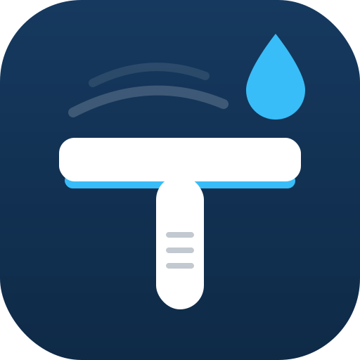
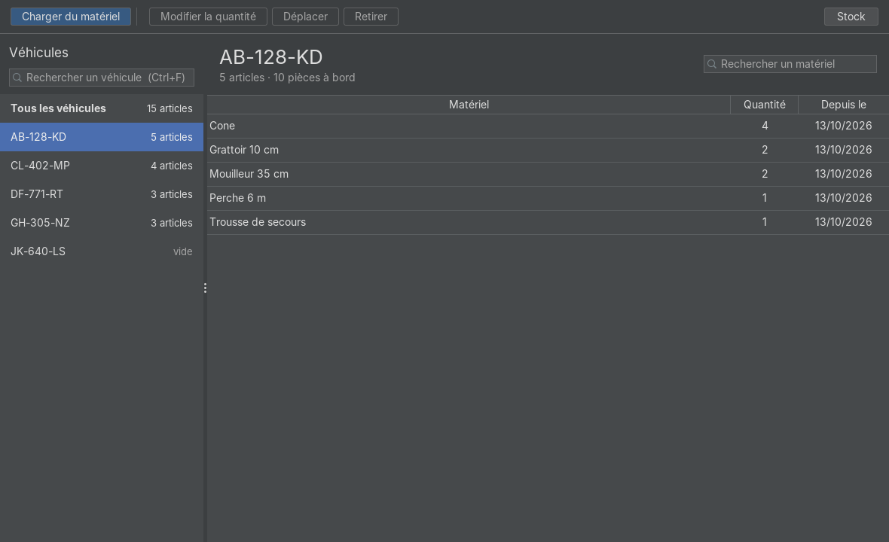
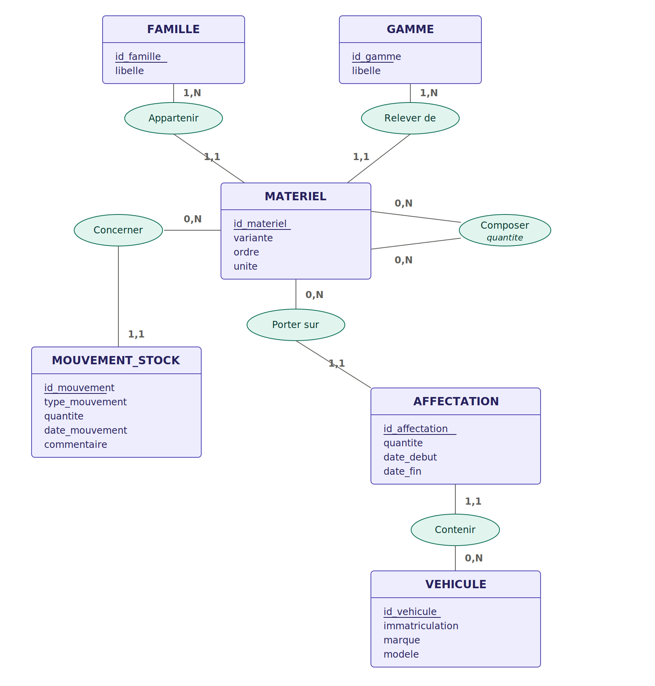

<p align="center">
  
</p>

<h1 align="center">ISO Stock</h1>

<p align="center">
  Suivi du matériel embarqué dans une flotte de véhicules d'intervention.<br>
  Application de bureau Java · SQLite · Swing
</p>

<p align="center">
  
</p>

## Contexte

Une entreprise de lavage de vitres équipe chacune de ses camionnettes en matériel :
grattoirs, mouilleurs, perches, échelles, machines à eau pure… Jusqu'ici, le suivi
se faisait dans un tableur, où la taille d'un vêtement finissait parfois dans la
colonne « quantité » faute de mieux.

ISO Stock répond à une question simple : **quel matériel se trouve dans quel véhicule ?**
Et, par extension, combien l'entreprise en possède et combien reste disponible.

Le projet part d'un besoin réel : règles de gestion recueillies auprès du commanditaire,
parc importé depuis ses propres listes (28 véhicules, 81 articles).

## Fonctionnalités

- Vue maître-détail : les véhicules à gauche avec ce qu'ils ont à bord, le chargement
  du véhicule choisi à droite — les camions vides se repèrent d'un coup d'œil
- Recherche de véhicule (`Ctrl+F`, insensible aux tirets et à la casse) et de matériel
- Chargement, déplacement, modification de quantité et retrait de matériel
- Gestes de bureau : double-clic pour modifier, clic droit, `Suppr` pour retirer,
  `Entrée` pour valider, `Échap` pour annuler
- Gestion du stock par mouvements : achats, casse, perte, inventaire
- Contrôle du disponible : impossible de charger plus que ce que l'entreprise possède
- Historique complet : rien n'est jamais supprimé, les affectations sont clôturées
- Import initial du parc depuis des fichiers CSV
- Aucun serveur : une base SQLite locale, l'application tient sur une clé USB

## Architecture

Architecture en couches, chaque couche ne parlant qu'à celle du dessous :

```
ui  →  service  →  dao  →  base SQLite
```

```
src/main/java/fr/taevie/parc/
├── model/     Objets métier : Famille, Gamme, Materiel, Vehicule, Affectation…
├── dao/       Accès aux données en JDBC — le seul endroit où l'on écrit du SQL
├── service/   Règles de gestion (stock disponible, cumul, historique…)
└── ui/        Interface Swing, thème FlatLaf
```

Quelques choix notables :

- **Le stock total n'est jamais stocké.** Il est la somme des mouvements, comme un solde
  bancaire est la somme des opérations. Une erreur se corrige par un mouvement
  d'ajustement, pas en écrasant une valeur.
- **Les affectations ne sont jamais modifiées ni supprimées.** Changer une quantité
  clôture la ligne en cours et en crée une nouvelle : l'historique reste exact.
- **Une seule affectation active par couple matériel/véhicule**, garantie au niveau de la
  base par un index unique partiel (`WHERE date_fin IS NULL`).
- **Jointures plutôt que requêtes en cascade** : un matériel est relu avec sa famille et
  sa gamme en une seule requête, sans problème N+1.

## Modèle de données

<p align="center">
  
</p>

Un matériel se définit par une **famille** (Grattoir), une **gamme** (Standard, PAD, UNGER)
et une **variante** (10 cm, 4 m, XL…). Un kit peut être composé d'autres matériels.
Le schéma complet, commenté, est dans [`schema.sql`](src/main/resources/schema.sql).

## Règles de gestion testées

| Règle | Énoncé | Test |
|---|---|---|
| RG7 | Le stock total est la somme des mouvements | `MouvementStockServiceTest` |
| RG8 | On ne charge pas plus que le stock disponible | `AffectationServiceTest` |
| RG15 | Retirer clôture l'affectation au lieu de la supprimer | `AffectationServiceTest` |
| RG16 | Une seule affectation active par couple matériel/véhicule | `AffectationServiceTest` |
| RG20 | Un inventaire enregistre l'écart, sans réécrire l'historique | `MouvementStockServiceTest` |
| RG21 | Pas de casse déclarée sur du matériel encore chargé | `MouvementStockServiceTest` |
| RG29 | Recharger un matériel déjà présent cumule les quantités | `AffectationServiceTest` |

Chaque test travaille sur une base SQLite temporaire, créée puis supprimée :
les données réelles ne sont jamais touchées.

## Lancer le projet

Prérequis : JDK 17 ou plus récent, Maven.

```bash
mvn test              # lance les 15 tests
mvn clean package     # produit target/ISO-Stock.jar, exécutable autonome
```

Dans IntelliJ IDEA : ouvrir le dossier, laisser Maven importer le projet,
puis lancer `fr.taevie.parc.Main`.

## Livraison

### Version autonome (recommandée) : rien à installer chez le client

Le script [`distribution/construire-exe.bat`](distribution/construire-exe.bat) appelle
`jpackage` (fourni avec le JDK) pour fabriquer un dossier qui contient l'application
**et son propre Java**, réduit aux seuls modules utilisés grâce à `jlink` :

```
ISO Stock/
├── ISO Stock.exe     ← double-clic, avec le logo
├── app/              ← le JAR
├── runtime/          ← Java embarqué (≈ 70 Mo au total)
├── LISEZMOI.txt
└── parc.db           ← créé au premier lancement
```

Étapes, sous Windows : `mvn clean package` (ou panneau Maven → `package` dans IntelliJ),
puis double-clic sur `distribution/construire-exe.bat`. Le dossier à livrer apparaît
dans `target/livraison/`.

La base se place à côté de l'exécutable : `Database` lit la propriété système
`jpackage.app-path`, que le lanceur renseigne avec son propre chemin.

### Version JAR : Java 17+ requis sur le poste

```
ISO Stock/
├── ISO-Stock.jar     ← copié depuis target/
├── lancer.bat        ← double-clic pour démarrer
├── depannage.bat     ← affiche les erreurs si rien ne s'ouvre
└── LISEZMOI.txt
```

Dans les deux cas, la base `parc.db` est créée au premier lancement et le parc
est importé automatiquement.

## Stack

Java 17 · Swing · [FlatLaf](https://www.formdev.com/flatlaf/) · SQLite
([sqlite-jdbc](https://github.com/xerial/sqlite-jdbc)) · JDBC · Maven · JUnit 5

---

Projet réalisé par TaeVie, en BTS SIO option SLAM.
